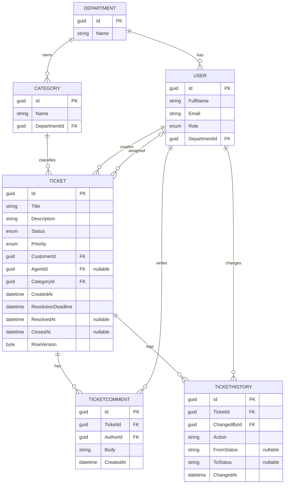
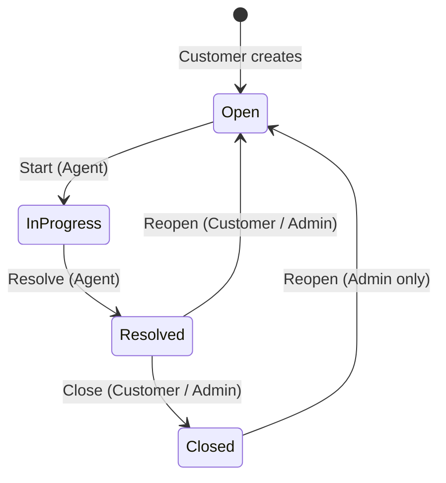

# SupportDesk - Phase 1: Requirements and Domain Design

A Support Desk and Issue Tracking System. A customer opens a Ticket, an agent claims it (or an admin assigns it), the agent works on it and comments until it is resolved, the system records the history of every change, and requests that miss their SLA deadline are detected.

This document is the output of Phase 1. It is analysis only: no code and no new technology.

---

## 1. Users and permissions

Roles: **Customer**, **SupportAgent**, **Admin**.

| Action | Customer | SupportAgent | Admin |
|---|---|---|---|
| Create a Ticket | Yes | No | No |
| View Tickets | Own Tickets | Assigned to them + unassigned | All |
| Claim a Ticket (self-claim) | No | Unassigned Tickets only | No |
| Assign / reassign a Ticket | No | No | Yes |
| Start work | No | Assigned to them | No |
| Comment | Own Tickets | Assigned to them | Any Ticket |
| Resolve | No | Assigned to them | No |
| Close | Own Ticket, after Resolved | No | After Resolved |
| Reopen | Own Ticket, from Resolved | No | From Resolved or Closed |
| Manage Categories / Departments / Users | No | No | Yes |

"Own" and "assigned to them" are resource-based rules: they depend on the Ticket itself, not only on the role. They are enforced in Phase 5.

---

## 2. Entities and ERD

Entities: `User`, `Ticket`, `TicketComment`, `TicketHistory`, `Category`, `Department`.

Notes:
- `AgentId` is nullable because a new Ticket starts unassigned. This is what makes self-claim possible.
- `RowVersion` is in the design from now. It is explained and implemented in Phase 3 (Optimistic Concurrency).
- `TicketHistory` is append-only: no update, no delete.
- A Category belongs to a Department, so a Ticket reaches the right team through its Category.

---

## 3. Lifecycle and allowed transitions

| From | To | Action | Who | Condition |
|---|---|---|---|---|
| (new) | Open | Create | Customer | Title, Description, Category required |
| Open | InProgress | Start | Assigned agent | Ticket must be assigned to the actor |
| InProgress | Resolved | Resolve | Assigned agent | Sets `ResolvedAt` |
| Resolved | Closed | Close | Owner Customer or Admin | Sets `ClosedAt` |
| Resolved | Open | Reopen | Owner Customer or Admin | Unassigns agent, resets deadline |
| Closed | Open | Reopen | Admin only | Unassigns agent, resets deadline |

Any transition not in this table is forbidden (for example Open -> Resolved, Open -> Closed, InProgress -> Closed).

Assign and self-claim do not change the status. The Ticket stays Open until the agent starts work.

---

## 4. Business rules

**Creation**
- BR-01: A Ticket requires a Title, a Description and a Category.
- BR-02: A new Ticket is Open and unassigned (`AgentId = null`).
- BR-03: Only a Customer can create a Ticket.

**Assignment and claiming**
- BR-04: A Ticket must be Open to be assigned or claimed.
- BR-05: A Ticket can only be assigned to a user whose role is SupportAgent.
- BR-06: Self-claim is allowed only for an agent, and only on an unassigned Ticket.
- BR-07: If two agents claim the same Ticket at the same moment, exactly one succeeds and the other gets a clear rejection (Optimistic Concurrency, Phase 3).

**Lifecycle**
- BR-08: Start requires the Ticket to be Open and assigned to the acting agent.
- BR-09: Resolve requires the Ticket to be InProgress and the actor to be the assigned agent.
- BR-10: Close requires the Ticket to be Resolved, performed by the owner Customer or an Admin.
- BR-11: Any transition outside the table in section 3 is rejected.
- BR-12: Reopen from Closed is Admin only. Every Reopen returns the Ticket to Open and unassigns the agent (it goes back to the queue).

**Comments**
- BR-13: Comments are rejected on a Closed Ticket.
- BR-14: A Customer comments only on their own Tickets. An agent comments only on Tickets assigned to them.

**History**
- BR-15: Every status change and every assignment writes a `TicketHistory` row in the same transaction as the change.
- BR-16: `TicketHistory` rows are never updated or deleted.

**SLA**
- BR-17: A Ticket is overdue when its status is Open or InProgress and the current UTC time is after `ResolutionDeadline`. Resolved and Closed Tickets are never overdue.
- BR-18: `ResolutionDeadline` is calculated at creation as creation time + the duration of the Ticket's Priority, and is stored on the Ticket.
- BR-19: On Reopen, the new deadline is reopen time + the duration of the Priority, and the previous deadline is recorded in the `TicketHistory` row for that Reopen.
- BR-20: `Priority` is set at creation and never changes. Therefore `ResolutionDeadline` changes only at creation and at Reopen.

---

## 5. SLA field

- Field: `ResolutionDeadline` (DateTime, UTC, required).
- Stored on the Ticket as a fixed value, not recalculated on every read, so a later change in SLA policy does not rewrite the deadline of existing Tickets.
- Initial durations by Priority (a starting point, to be moved to configuration in Phase 2):

| Priority | Resolution time |
|---|---|
| Low | 72 hours |
| Medium | 48 hours |
| High | 24 hours |
| Urgent | 4 hours |

- A Ticket resolved after its deadline is not "overdue" (see BR-17), but `ResolvedAt > ResolutionDeadline` shows it was resolved late, which is useful for reports.

---

## 6. Decisions log

Each decision with the options considered and the reason, for the README later.

| # | Decision | Options considered | Why |
|---|---|---|---|
| D1 | Agents can self-claim unassigned Tickets, and Admin can also assign | Admin-only assignment; self-claim only | Matches real support desks (a queue agents pull from) and creates the real concurrency scenario studied in Phase 3 |
| D2 | Close allowed for the owner Customer and for Admin | Customer only; Admin only | The customer confirms the fix; Admin covers the case where the customer goes silent |
| D3 | Reopen: owner Customer from Resolved; Admin from Resolved or Closed | Customer from any state | Prevents customers from reviving old Tickets and distorting the SLA |
| D4 | Category belongs to Department | Independent Category | Routes Tickets to the right team through the Category |
| D5 | Reopen returns the Ticket to Open and unassigns the agent | Keep same agent; go straight to InProgress | A failed first fix benefits from fresh eyes, and `Open` always means "ready to be claimed". Previous agent is still visible in `TicketHistory`, and Admin can reassign to them directly |
| D6 | Deadline determined by Priority | One fixed deadline for all; deadline by Category | Uses an existing field, and urgent issues get shorter deadlines |
| D7 | On Reopen the deadline is reset from reopen time | Keep the old deadline; shorter new deadline | A Ticket that returns to the queue with an expired deadline would be overdue before anyone touches it. The old deadline is kept in History so the original delay is not lost |
| D8 | Priority is fixed after creation | Admin can change it and the deadline is recalculated | Simplest rule for this scope. Escalation can be added later as an enhancement |

---

## 7. Does the system prevent each rule, or rely on user behavior?

| Rule | Prevented by | Phase |
|---|---|---|
| BR-01 | Input validation | 4 |
| BR-02 | The Ticket entity itself (constructor) | 3 |
| BR-03, BR-14 | Authorization | 5 |
| BR-04, BR-05 | Domain: `Assign` method validates | 3 |
| BR-06, BR-07 | Domain + Optimistic Concurrency | 3 |
| BR-08 to BR-12 | State machine inside the entity | 3 |
| BR-13 | Domain | 3 |
| BR-15, BR-16 | Same transaction; no API that edits History | 3 |
| BR-17 | Query + background job | 7 |
| BR-18 to BR-20 | Domain: calculation lives inside the entity | 3 |

No rule depends on the user behaving correctly. Domain rules (transitions, assignment, SLA) are enforced inside the entity, not in controllers, so no code path can bypass them.

---

## 8. Exit checklist

- [ ] I understand every section and can explain it.
- [ ] I wrote this document myself.
- [ ] Every rule has a clear mechanism that prevents its violation.
- [ ] Clear commit, with a short summary of the decisions (D1 to D8).
